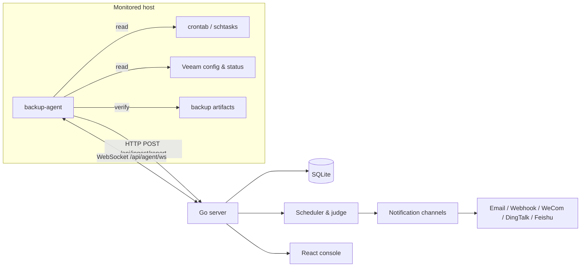

<div align="center">

<h1>Backup Monitor</h1>

<p><b>Self-hosted backup monitoring</b> — hosts · tasks · executions · alerts · notifications · agent management</p>

<p><a href="README.md">简体中文</a> · <b>English</b></p>

Backup jobs live in crontabs, Windows scheduled tasks and Veeam, and whether they actually ran usually surfaces only when something breaks.  
Backup Monitor brings them into one **self-hosted** system: Go server + React console + non-intrusive agent + single-file SQLite.  
One machine, one `docker compose up -d`, or a Release binary is all it takes.  
Data, logs and binaries stay on your own disks; the repository holds no tokens, passwords or real hostnames.

<p>
  <a href="LICENSE"></a>
  <a href="https://go.dev/"></a>
  <a href="https://react.dev/"></a>
  <a href="https://www.sqlite.org/"></a>
  
  
</p>

<p>
  <b><a href="#project-preview">Preview</a></b> ·
  <a href="#what-it-does">What it does</a> ·
  <a href="#how-it-works">How it works</a> ·
  <a href="#stack">Stack</a> ·
  <a href="#quick-start">Quick start</a> ·
  <a href="#deployment">Deployment</a> ·
  <a href="#permission-model">Permissions</a> ·
  <a href="#data-and-security">Security</a> ·
  <a href="#faq">FAQ</a> ·
  <a href="#repository-layout">Layout</a> ·
  <a href="#documentation">Docs</a>
</p>

</div>

---

The server uses a pure-Go SQLite driver — **no CGO, no GCC, no external database**. The console is React 19 rendered through Nitro SSR. The agent is an independent Go module that ships as a single binary and only reads scheduled tasks, status files and artifact metadata.

## Project preview

### Login

An internal system with no public sign-up. Sign in with a local account; AD/LDAP and WeCom QR login can be enabled under **System Settings → Authentication**. Password recovery uses a captcha plus an email verification code.


### Overview

The dashboard summarises hosts, tasks, today's runs, success rate, abnormal tasks and open alerts, together with a 14-day execution trend and task state distribution. The sidebar only shows the sections the signed-in user has permission to read.


## What it does

### Monitoring and judgement

| Area | Highlights |
| --- | --- |
| Hosts | Hostname, node ID, IP, OS, role, agent version, online state, task count |
| Discovery | crontab, Windows scheduled tasks, Veeam jobs, manually registered tasks |
| Executions | Session ID, state, trigger, start/end time, sizes, artifact path, exit code |
| Judgement | Success / running / failed / missed / no data, consecutive failures and success rate |
| Alerts | Backup failure, missed run and host offline; deduplicated, auto-resolved and exportable |
| Notifications | Mail, webhook, WeCom, DingTalk, Feishu; routed by event type and severity; WeCom/DingTalk support Markdown, Feishu supports rich text and cards |

Default thresholds (editable in **System Settings → Basic → Thresholds & retention / Agent channel / Security & alerts**):

- Host abnormal after **3 min** without a report, offline after **6 min**
- A run counts as missed **30 min** after its scheduled time
- Schedule match window **60 min**, scheduler interval **30 s**
- Executions, notifications and audit logs retained **90 days**, alerts deduplicated by default

### Console

- **Overview**: hosts/tasks/today's runs/success rate/abnormal tasks/open alerts, 14-day trend, status distribution.
- **Hosts**: search, state and platform filters, host detail, role maintenance, cascade delete.
- **Tasks**: filter by host/method/state, execution history, profile inspection, edit cron online with agent receipt.
- **Executions**: full details, duration, sizes, artifact path and error message.
- **Alerts**: filter by state/type/severity, resolve and export.
- **Notifications**: channel maintenance, event subscriptions, severity filters, enable/recovery, delivery records.
- **Agent management**: collection profiles, agent tokens, Linux/Windows binaries and self-update push.
- **System settings**: branding, session/retention thresholds, users/roles/groups, LDAP and WeCom auth, password-reset mail.
- **Audit log**: login, configuration changes, task and alert operations.

## How it works



1. The agent discovers tasks (crontab tags, Windows scheduled tasks, Veeam jobs) from the profile the server hands out, then reads status files and artifact metadata.
2. It reports hosts, tasks and executions through `POST /api/ingest/report`; without a profile it only sends heartbeats.
3. The server matches schedules and judges missed / failed / running states, and detects host loss.
4. Verdicts flow into the alert center and are pushed through channels by event subscription and severity; recovery notices follow the channel setting.
5. The WebSocket channel carries profile changes, cron edits and self-updates; the agent receipt is shown back in the console.

### Agent protocol at a glance

| Method | Path | Purpose |
| --- | --- | --- |
| `POST` | `/api/ingest/report` | Report host, tasks, executions and alert hints |
| `GET` | `/api/agent/config?hostname=&platform=` | Fetch global settings and the matching profile |
| `GET` | `/api/agent/ws?hostname=&nodeId=&platform=` | WebSocket for profile changes, cron edits and updates |
| `GET` | `/api/agent/download?platform=&arch=&variant=` | Download the hosted agent binary for a platform/arch/variant (platform required) |
| `GET` | `/api/agent/binary/latest?platform=&arch=&osBuild=` | Query the latest version, architecture and SHA-256 (platform required) |
| `GET` | `/download/backup-agent?platform=&arch=&variant=` | Public binary download for first-time deployment |

Auth header: `X-Agent-Token` when token enforcement is on. Downstream messages: `config_changed`, `set_cron`, `update`; agent receipts: `set_cron_result`, `update_result`. Full definitions in [docs/agent-protocol.md](docs/agent-protocol.md).

## Stack

| Layer | Technology |
| --- | --- |
| Backend | Go 1.25, chi v5, modernc.org/sqlite, JWT, gorilla/websocket |
| Frontend | React 19, TanStack Start/Router/Query, Tailwind CSS 4, Radix UI |
| Agent | Go 1.22+ for Linux and Windows |
| Storage | SQLite (WAL), single file |

## Quick start

### 1. Start the server

```bash
cd backend
go run ./cmd/server
```

Listens on `127.0.0.1:8080`, database at `./data/backup_monitor.db`. The first start creates the schema and an administrator `admin / admin123` — change it immediately after logging in.

Common environment variables:

| Variable | Default | Description |
| --- | --- | --- |
| `SERVER_ADDR` | `127.0.0.1:8080` | Listen address; use `0.0.0.0:8080` in containers. Falls back to `ADDR` or `127.0.0.1:$PORT` |
| `DB_PATH` | `./data/backup_monitor.db` | SQLite file path |
| `JWT_SECRET` | Generated and persisted | JWT signing key |
| `SESSION_TTL_HOURS` | `12` | Session lifetime |
| `CORS_ORIGINS` | `*` | Allowed origins, comma separated |

### 2. Start the console

```bash
cd frontend
npm ci
npm run dev
```

Open `http://127.0.0.1:5173`. Production build with `npm run build` (Nitro writes `.output/`). Point the dev proxy at the API with `VITE_API_BASE_URL`; SSR can override it with `SSR_API_ORIGIN`.

### 3. Deploy the agent

If a binary has been uploaded to the server, pull it directly without a token:

```bash
curl -fLo backup-agent "http://<server>/download/backup-agent?platform=linux"
chmod +x backup-agent
```

Or build from source:

```bash
cd agent
go build -trimpath -ldflags "-s -w" -o backup-agent ./cmd/backup-agent
```

Linux:

```bash
sudo mkdir -p /etc/backup-agent
sudo tee /etc/backup-agent/backup-agent.json >/dev/null <<'EOF'
{
  "serverUrl": "http://10.0.0.10:8080",
  "token": "<AGENT_TOKEN>",
  "hostname": "",
  "role": "database"
}
EOF
sudo ./backup-agent -install
sudo systemctl status backup-agent
```

Windows (elevated PowerShell):

```powershell
New-Item -ItemType Directory -Force "$env:ProgramData\backup-agent"
@'
{
  "serverUrl": "http://10.0.0.10:8080",
  "token": "<AGENT_TOKEN>",
  "hostname": "",
  "role": "database"
}
'@ | Set-Content "$env:ProgramData\backup-agent\backup-agent.json" -Encoding utf8
.\backup-agent.exe -install
Get-Service backup-agent
```

Run it in the foreground instead with `./backup-agent -config /etc/backup-agent/backup-agent.json`, or use `-once` for a single collection and report. Logs default to `agent.log` next to the binary; see [agent/README.md](agent/README.md) for configuration and discovery rules.

### 4. Onboard and verify

1. Sign in and create a token under **Agent Management → Agent Tokens** (or turn the token requirement off).
2. Add a collection profile under **Agent Management → Profiles** (`*` as the fallback hostname match).
3. Once the agent starts it fetches the profile and reports on schedule; hosts appear under **Overview** when onboarding succeeds.
4. Under **Agent Management → Agent Updates**, upload Linux/Windows binaries. The server files them into five slots by platform, architecture and Go version (Windows amd64 also has a legacy slot), and each push picks the matching slot per host by architecture and Windows build. Hosts without a matching package are skipped and listed in the result. Windows needs a one-time manual service install; later updates can be pushed remotely.

## Deployment

Only two options are supported: **Docker** (recommended) and **Release binaries**. Source builds, a bare systemd setup and full Nginx examples live in [chapter 4 of the manual](docs/manual.md).

### Option 1: Docker

The image bundles the Go server, Nginx and the Nitro SSR console, supervised by Supervisor, and exposes only port 80. No clone required — one command brings it up (replace `JWT_SECRET` with a long random string):

```bash
docker run -d \
  --name backup-monitor \
  --privileged \
  --restart unless-stopped \
  -p 80:80 \
  -e JWT_SECRET=replace-with-a-long-random-string \
  -e SESSION_TTL_HOURS=12 \
  -e CORS_ORIGINS='*' \
  -v "$(pwd)/data:/app/data" \
  registry.cn-shenzhen.aliyuncs.com/zyx3721/backup-monitor:latest
```

> On Windows PowerShell, replace `-v "$(pwd)/data:/app/data"` with `-v "${PWD}/data:/app/data"`.

The container creates `data/` in the current directory and mounts it at `/app/data`:

```text
data/
├── backup_monitor.db   # SQLite database (created on first start)
├── agents/             # hosted agent binaries (created after upload)
└── logs/               # runtime logs
```

Available environment variables:

| Variable | Default | Description |
| --- | --- | --- |
| `JWT_SECRET` | empty | JWT signing key; when empty a random key is generated on first start and persisted |
| `SESSION_TTL_HOURS` | `12` | Session lifetime in hours, positive integer |
| `CORS_ORIGINS` | `*` | Allowed origins, comma separated |
| `SERVER_ADDR` | `127.0.0.1:8080` | Backend listen address; Nginx proxies it inside the container, keep the default |
| `DB_PATH` | `./data/backup_monitor.db` | SQLite path, relative to `/app` in the container |

A Compose file is included for source checkouts:

```bash
cd deploy
cp .env.example .env     # adjust JWT_SECRET and friends
docker compose up -d
```

To build the image locally, `deploy/Dockerfile` needs the repository:

```bash
git clone https://github.com/zyx3721/backup-monitor.git && cd backup-monitor/deploy
docker build -f Dockerfile -t backup-monitor:latest --build-arg ALPINE_MIRROR=mirrors.aliyun.com ..
```

Then swap the image name at the end of the `docker run` command for `backup-monitor:latest` and recreate the container.

Operations:

```bash
docker ps --filter name=backup-monitor      # status
docker logs -f backup-monitor               # live logs
docker restart backup-monitor               # restart
docker stop backup-monitor                  # stop
docker stop backup-monitor && docker rm backup-monitor   # remove (data stays in ./data)

# Upgrade: pull, then recreate with the docker run command above
docker pull registry.cn-shenzhen.aliyuncs.com/zyx3721/backup-monitor:latest
```

**Access**

- Console: `http://your-host/`, default account `admin / admin123`
- API docs: `http://your-host/swagger/index.html`
- Health check: `http://your-host/api/health`

To front the service with a host-level domain, HTTPS or multiple sites, publish a non-80 port (`-p 80:80` → `-p 8080:80`) and reverse proxy to the container. See [manual section 3.7](docs/manual.md).

### Option 2: Release binaries

Download the package matching your OS and CPU architecture from [GitHub Releases](https://github.com/zyx3721/backup-monitor/releases), then verify, extract, configure and start.

**Which package**

| Your machine | File |
| --- | --- |
| Linux x86_64 | `backup-monitor_<version>_linux_amd64.tar.gz` |
| Linux ARM64 (Kunpeng, Phytium …) | `backup-monitor_<version>_linux_arm64.tar.gz` |
| Windows x86_64 | `backup-monitor_<version>_windows_amd64.zip` |
| Windows ARM64 | `backup-monitor_<version>_windows_arm64.zip` |
| Console (required on any platform) | `backup-monitor-frontend_<version>.tar.gz` |
| Agent (per monitored host) | `backup-agent_<version>_linux_amd64.tar.gz`, `backup-agent_<version>_windows_amd64.zip` and two more |
| Checksums | `SHA256SUMS` |

The server package contains the `backup-monitor` binary (`.exe` on Windows), `.env.example` and `README.txt`; the console package contains the Nitro SSR `.output` tree. The server binary has no runtime dependencies; the console needs Node.js.

Agent binaries are **not shipped with an application release**: they have their own version line and tag (`agent-vX.Y.Z`), which do not track the application version — look for the release titled `Agent vX.Y.Z` on the Releases page. You can also skip the download entirely and upload a binary under **Agent management** in the console for the server to distribute.

**1. Verify**

```bash
VERSION=1.0.0
mkdir -p /data/backup-monitor && cd /data/backup-monitor
sha256sum -c SHA256SUMS
```

**2. Extract**

```bash
mkdir -p backend frontend/.output
tar -xzf backup-monitor_${VERSION}_linux_amd64.tar.gz -C backend --strip-components=1
tar -xzf backup-monitor-frontend_${VERSION}.tar.gz -C frontend/.output
```

Resulting layout:

```text
/data/backup-monitor/
├── backend/
│   ├── backup-monitor       # server binary
│   ├── .env.example
│   └── data/                # created on first start: backup_monitor.db, agents/, logs/
└── frontend/
    └── .output/
        ├── public/          # browser assets
        └── server/
            └── index.mjs    # Nitro SSR entry
```

**3. Configure and start the server**

```bash
cd /data/backup-monitor/backend
cp .env.example .env
vim .env                      # at least set JWT_SECRET
./backup-monitor
```

The server listens on `127.0.0.1:8080` and creates `data/backup_monitor.db` in the working directory.

Command-line flags take precedence over environment variables and `.env`; `./backup-monitor -v` prints version information and `-h` lists every flag:

| Flag | Env variable | Description |
| --- | --- | --- |
| `-addr` | `SERVER_ADDR` | Listen address |
| `-port` | `PORT` | Listen port, used when `-addr` is unset |
| `-db` | `DB_PATH` | SQLite database path |
| `-jwt-secret` | `JWT_SECRET` | JWT signing key |
| `-session-ttl` | `SESSION_TTL_HOURS` | Session lifetime in hours |
| `-cors-origins` | `CORS_ORIGINS` | Allowed origins, comma separated |
| `-env` | — | Path to the `.env` file |
| `-v`, `-version` | — | Print version and exit |

To keep it running, hand it to systemd:

```ini
# /etc/systemd/system/backup-monitor.service
[Unit]
Description=Backup Monitor Backend
After=network.target

[Service]
Type=simple
WorkingDirectory=/data/backup-monitor/backend
ExecStart=/data/backup-monitor/backend/backup-monitor
Restart=on-failure
RestartSec=5

[Install]
WantedBy=multi-user.target
```

```bash
systemctl daemon-reload && systemctl enable --now backup-monitor
```

**4. Start the console SSR**

```bash
cd /data/backup-monitor/frontend
SSR_API_ORIGIN=http://127.0.0.1:8080 HOST=127.0.0.1 PORT=5173 node .output/server/index.mjs
```

SSR fetches the branding from the API so the site name and icon are part of the first HTML response. The API origin is resolved as: `SSR_API_ORIGIN` → the nearest `.env` above `index.mjs` (first one wins, may be shared with the backend) → `http://127.0.0.1:8080`. If it is unreachable the first paint shows the default brand and the SSR log prints `[bm-ssr] fetch brand failed`.

**5. Put Nginx in front**

```nginx
server {
    listen 80;
    server_name your-domain.com;

    # Built assets only
    location ^~ /assets/ {
        root /data/backup-monitor/frontend/.output/public;
        try_files $uri =404;
        expires 1y;
        add_header Cache-Control "public, immutable";
    }

    location /api/ {
        proxy_pass http://127.0.0.1:8080;
        proxy_set_header Host $host;
        proxy_set_header X-Real-IP $remote_addr;
        proxy_set_header X-Forwarded-For $proxy_add_x_forwarded_for;
        proxy_set_header X-Forwarded-Proto $scheme;
    }

    # SSE stream: disable buffering and extend the timeout
    location = /api/events {
        proxy_pass http://127.0.0.1:8080;
        proxy_http_version 1.1;
        proxy_set_header Connection "";
        proxy_set_header Host $host;
        proxy_read_timeout 3600s;
        proxy_buffering off;
    }

    location /swagger/ {
        proxy_pass http://127.0.0.1:8080;
        proxy_set_header Host $host;
    }

    location = /api/health {
        proxy_pass http://127.0.0.1:8080/api/health;
    }

    location / {
        proxy_pass http://127.0.0.1:5173;
        proxy_set_header Host $host;
        proxy_set_header X-Real-IP $remote_addr;
        proxy_set_header X-Forwarded-For $proxy_add_x_forwarded_for;
        proxy_set_header X-Forwarded-Proto $scheme;
    }
}
```

The console must be served by `node .output/server/index.mjs`; **pointing Nginx at `.output/public` alone breaks server-rendered pages**. HTTPS and the 80→443 redirect are in [manual section 4.5](docs/manual.md).

**6. Access**

Same as Docker: console `http://your-domain.com` (`admin / admin123`), API docs `/swagger/index.html`, health check `/api/health`.

## Permission model

- **23 permission keys**, designed as `<domain>.<resource>.read` / `.manage` pairs; `manage` implies `read`
- Grouped by the nine sidebar sections: Overview, Hosts, Tasks, Executions, Alerts, Notifications, Agent Management, Audit Log, System Settings (basic/users/auth/password-reset)
- The built-in `admin` role holds every permission; other roles are configured under **System Settings → Users → Roles**
- Pages are gated by the sidebar: without `read` on a collection the page is not rendered and a contact-your-administrator notice appears instead
- Users without overview permission are redirected to the first accessible section after login

## Data and security

- The agent collects backup task and artifact metadata only; artifact checks read size and modification time, never backup content.
- Channel secrets and SMTP passwords are encrypted with a server key before being stored.
- Every console change is written to the audit log; deleting a host or task cascades to its executions and alerts.
- In production, enable agent tokens, front the service with HTTPS, and change the default administrator password.

## API documentation

- Swagger UI: `http://<server>/swagger/index.html`
- OpenAPI JSON: `http://<server>/swagger/doc.json`
- **89 endpoints** grouped as: system settings, authentication, agent management, notifications, agent channel, backup tasks, backup hosts, alert center, audit log, executions, health, overview
- Full endpoint list (parameters, permissions, examples) in [docs/manual.md](docs/manual.md) chapter 5

## Database

- Single SQLite file, default `backend/data/backup_monitor.db`, `MaxOpenConns(1)`, WAL enabled
- **25 tables**: 16 platform tables (users, roles, groups, settings, audit, sessions, …) and 9 backup tables (hosts, tasks, executions, alerts, channels, deliveries, profiles, agent tokens, agent binaries)
- All time columns store UTC millisecond ISO text (e.g. `2026-10-22T06:39:34.691Z`)
- Schema details in [docs/database-design.md](docs/database-design.md)

## FAQ

**I forgot the administrator password.**

Stop the server and update the database (recommended, no data loss):

```bash
# users.pass must be a valid bcrypt hash; plaintext cannot be used to sign in
sqlite3 backend/data/backup_monitor.db "UPDATE users SET pass = '<bcrypt hash>' WHERE username = 'admin';"
```

**A host stays offline.**

Three usual causes: the agent is not running (`systemctl status backup-agent`), `serverUrl` is unreachable, or `X-Agent-Token` does not match a server token. The agent log is `agent.log` next to the binary.

**A task is marked "missed" although it did run.**

A run is only marked missed when nothing arrives **30 minutes** after the scheduled time, and records are matched within a **60-minute** window; records outside it cannot backfill the verdict. If the task was never discovered at all, check that a profile under **Agent Management → Profiles** matches its hostname, then read the agent log.

**Notifications are not delivered.**

Check the channel's event subscription and severity filter first, then the delivery records under **Notifications → Send records**. Mail channels do not have their own SMTP settings — they reuse **System Settings → Password reset → Mail**, where you can send a test mail.

**An uploaded agent binary has no version.**

Build with the package directory, `go build ./cmd/backup-agent`: `version_marker.go` in that directory embeds `backup-agent-version:X.Y.Z`, which the server uses to detect version and architecture. Compiling `main.go` alone drops the marker, so the version must be entered by hand.

**Why can't the built console be served from a static directory?**

The console is a TanStack Start + Nitro SSR application: pages come from `node .output/server/index.mjs`, and a static root only serves `/assets/`.

More answers in [chapter 7 of the manual](docs/manual.md).

## Repository layout

```text
backup-monitor/
├── agent/                       host agent (independent Go module)
│   ├── cmd/backup-agent/        entry, flag parsing and version marker
│   └── internal/                collection, discovery, reporting, config, logging, service
├── backend/                     Go API server
│   ├── cmd/server/              entry point
│   ├── config/                  environment variables and .env loading
│   ├── docs/                    generated Swagger/OpenAPI artifacts
│   ├── internal/                domain models, repositories, services, infrastructure
│   │   ├── buildinfo/           version, commit and build time injection
│   │   ├── common/              cross-module helpers and error localisation
│   │   ├── domain/              backup monitoring and platform models
│   │   ├── repository/          SQLite access, schema and queries
│   │   ├── security/            password hashing and config secret encryption
│   │   └── service/             judge, scheduler, notifier, WS hub, agent binaries
│   ├── router/                  HTTP routing assembly and global middleware
│   │   ├── auth/                login, password reset and change
│   │   ├── backup/              agent channel and management endpoints
│   │   ├── common/              responses, auth context and database bootstrap
│   │   ├── middleware/          CORS, logging and permission middleware
│   │   ├── settings/            base config, users and roles, auth and mail
│   │   ├── swagger/             Swagger UI mount
│   │   └── system/              audit log and schema SQL
│   ├── data/                    SQLite database and agent binaries (runtime)
│   └── .env.example             environment variable template
├── deploy/                      Docker image build and compose files
├── docs/                        manual, agent protocol, schema design, extraction record
├── frontend/                    React console
│   └── src/
│       ├── components/          layout, boot screen, tables and base UI
│       ├── features/            auth, backup monitoring, audit and settings domains
│       ├── lib/                 session, branding, API client, permissions, export
│       ├── routes/              TanStack Router pages
│       ├── router.tsx           router instance
│       ├── server.ts            server entry
│       ├── start.ts             client entry
│       └── styles.css           global styles and theme variables
├── scripts/                     local start and online update scripts
├── .github/workflows/           GitHub Actions build workflow
├── .gitignore                   Git ignore rules
├── LICENSE
├── README.md                    简体中文
└── README.en.md                 English (this file)
```

## Local verification

```bash
# Backend
cd backend && go build ./... && go vet ./... && go test ./...

# Frontend
cd frontend && npm run type-check && npm run lint && npm run build

# Agent
cd agent && go build ./... && go vet ./... && go test ./...
```

## Documentation

| Document | Content |
| --- | --- |
| [docs/manual.md](docs/manual.md) | Full manual: Docker/Nginx deployment, source builds, endpoint list, schema, extension notes, troubleshooting |
| [docs/agent-protocol.md](docs/agent-protocol.md) | Agent reporting, profile fetch, WebSocket messages and receipts |
| [docs/database-design.md](docs/database-design.md) | Database design trade-offs; the full schema lives in manual chapters 6 and 12 |
| [docs/extraction-plan.md](docs/extraction-plan.md) | Historical template-extraction record (not the current structure) |
| [agent/README.en.md](agent/README.en.md) ([简体中文](agent/README.md)) | Agent build, configuration, discovery rules, service install, upgrade and rollback |

## Release history

The project ships on **two independent version lines**, versioned and recorded separately: the application (backend + frontend + image) uses `vX.Y.Z`, the agent uses `agent-vX.Y.Z`.

### Application

| Version | Released | Changelog |
| --- | --- | --- |
| v1.0.0 | 2026-10-26 | [v1.0.0](verchanglog/v1.0.0.md) |

### Agent

| Version | Released | Changelog |
| --- | --- | --- |

Both sets of artifacts and release notes live on [GitHub Releases](https://github.com/zyx3721/backup-monitor/releases), distinguished by tag prefix.

## Acknowledgements

Thanks to these open-source projects and communities:

- [go-chi/chi](https://github.com/go-chi/chi) — lightweight and fast Go HTTP router
- [modernc.org/sqlite](https://gitlab.com/cznic/sqlite) — pure-Go SQLite driver
- [gorilla/websocket](https://github.com/gorilla/websocket) — WebSocket client and server
- [swaggo/swag](https://github.com/swaggo/swag) — Swagger documentation generator
- [TanStack](https://tanstack.com/) — Router / Query / Start front-end suite
- [Tailwind CSS](https://tailwindcss.com/) — utility-first CSS framework
- [Radix UI](https://www.radix-ui.com/) — unstyled, accessible component primitives

## License

Released under the [MIT License](LICENSE): free to use, copy, modify, merge, publish, distribute, sublicense and sell, provided the copyright and license notices are retained in all copies or substantial portions.

## Contact

- **Email**: 416685476@qq.com
- **GitHub Issues**: [zyx3721/backup-monitor/issues](https://github.com/zyx3721/backup-monitor/issues)
- **Repository**: [github.com/zyx3721/backup-monitor](https://github.com/zyx3721/backup-monitor)

---

**⭐ If this project helps you, a star would be appreciated!**
