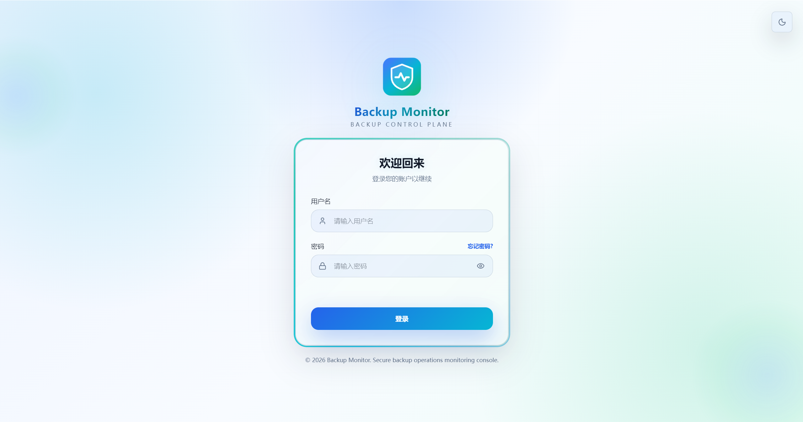
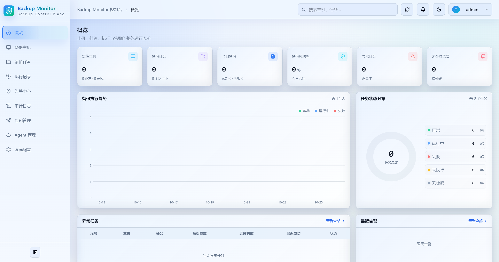
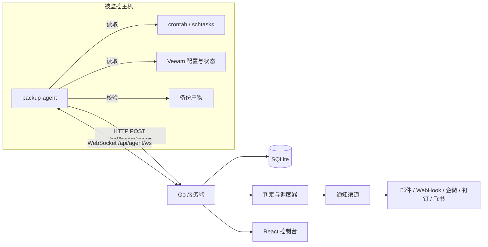

<div align="center">

<h1>Backup Monitor</h1>

<p><b>自托管备份监控平台</b> — 备份主机 · 备份任务 · 执行记录 · 告警中心 · 通知渠道 · Agent 管理</p>

<p><b>简体中文</b> · <a href="README.en.md">English</a></p>

备份脚本散落在 crontab、Windows 计划任务与 Veeam 里，跑没跑、成没成功，往往等出事才发现。  
Backup Monitor 把它们收进一套**自托管**的系统：Go 服务端 + React 控制台 + 无侵入 Agent + 单文件 SQLite。  
一台机器、一条 `docker compose up -d`，或一个从 Release 下载的二进制，就能跑起来。  
数据、日志与二进制都落在你自己的磁盘上；仓库里没有 Token、没有密码、没有真实主机名。

<p>
  <a href="LICENSE"></a>
  <a href="https://go.dev/"></a>
  <a href="https://react.dev/"></a>
  <a href="https://www.sqlite.org/"></a>
  
  
</p>

<p>
  <b><a href="#项目预览">项目预览</a></b> ·
  <a href="#它做什么">它做什么</a> ·
  <a href="#怎么工作">怎么工作</a> ·
  <a href="#技术栈">技术栈</a> ·
  <a href="#快速开始">快速开始</a> ·
  <a href="#部署">部署</a> ·
  <a href="#权限模型">权限</a> ·
  <a href="#数据与安全">安全</a> ·
  <a href="#常见问题">常见问题</a> ·
  <a href="#项目结构">项目结构</a> ·
  <a href="#文档">文档</a>
</p>

</div>

---

服务端用纯 Go 的 SQLite 驱动，**不需要 CGO、不需要 GCC、不需要外部数据库**；前端是 React 19 控制台，构建后由 Nitro 提供 SSR；Agent 是独立 Go module，编译成的单文件二进制在目标主机上直接运行，只读取计划任务、状态文件与备份产物元数据。

## 项目预览

### 登录

内部系统，没有公开注册。默认账号密码登录，可在「系统配置 → 认证配置」启用 AD/LDAP 与企业微信扫码登录；找回密码走图形验证码 + 邮箱验证码。



### 概览

仪表盘汇总主机、任务、今日执行、成功率、异常任务与未处理告警，并给出 14 天执行趋势与任务状态分布。侧栏按登录用户的权限逐项显示，没有权限的集合不会出现在菜单里。



## 它做什么

### 监控与判定

| 能力 | 说明 |
| --- | --- |
| 主机管理 | 主机名、节点 ID、IP、OS、角色、Agent 版本、在线状态、任务数 |
| 任务发现 | crontab、Windows 计划任务、Veeam Job、手工登记任务 |
| 执行记录 | 会话 ID、状态、触发方式、开始/结束时间、体积、产物路径、退出码 |
| 状态判定 | 正常 / 运行中 / 失败 / 未执行 / 无数据；连续失败与成功率统计 |
| 告警中心 | 备份失败、未按时执行、主机异常；告警去重、自动恢复与筛选导出 |
| 通知渠道 | 邮件、WebHook、企业微信、钉钉、飞书，按事件类型与级别分发；企业微信/钉钉支持 Markdown，飞书支持富文本与卡片 |

默认阈值（可在「系统配置 → 基础配置 → 判定与保留 / Agent 通道 / 安全与告警」调整）：

- 主机上报超时 **3 分钟**判为异常，**6 分钟**判为离线
- 计划时刻后 **30 分钟**仍无执行记录判为「未执行」
- 计划匹配窗口 **60 分钟**，巡检间隔 **30 秒**
- 执行记录保留 **90 天**，发送记录保留 **90 天**，审计日志保留 **90 天**，告警默认去重

### 管理端

- **概览**：主机/任务/今日执行/成功率/异常任务/未处理告警，14 天趋势、状态分布、异常任务与最近告警。
- **备份主机**：搜索、状态与平台筛选、主机详情、角色维护、级联删除。
- **备份任务**：按主机/方式/状态筛选，查看执行历史与采集配置，在线修改 cron 计划并等待 Agent 回执。
- **执行记录**：全量执行明细、耗时、体积、产物路径与错误信息。
- **告警中心**：按状态/类型/级别筛选，恢复与导出。
- **通知管理**：渠道维护、事件订阅、级别过滤、启用/恢复通知、发送记录。
- **Agent 管理**：采集配置、Agent 令牌与 Linux/Windows 二进制分发、自更新推送。
- **系统配置**：基础配置（品牌标识、安全时效、判定与保留、Agent 通道、安全与告警）、用户配置、认证配置（LDAP 与企业微信）、找密配置（邮件媒介）。
- **审计日志**：登录、配置变更、任务与告警操作全程留痕。

## 怎么工作



1. Agent 按服务端下发的采集配置发现任务（crontab 标签、Windows 计划任务、Veeam Job），读取状态文件与产物元数据。
2. Agent 通过 `POST /api/ingest/report` 周期上报主机、任务与执行记录；未接入时只发心跳。
3. 服务端按计划匹配与宽限期判定「未执行 / 失败 / 运行中」，并检测主机失联。
4. 判定结果进入告警中心，按渠道的事件订阅与级别过滤推送；恢复时按配置补发恢复通知。
5. WebSocket 长连接用于下发配置变更、修改 cron 与 Agent 自更新，Agent 回执后前端展示结果。

### Agent 协议摘要

| 方法 | 路径 | 说明 |
| --- | --- | --- |
| `POST` | `/api/ingest/report` | 上报主机、任务、执行记录与告警线索 |
| `GET` | `/api/agent/config?hostname=&platform=` | 拉取全局参数与匹配的采集配置 |
| `GET` | `/api/agent/ws?hostname=&nodeId=&platform=` | WebSocket 长连接（配置变更、改计划、自更新） |
| `GET` | `/api/agent/download?platform=&arch=&variant=` | 下载指定平台/架构/通道托管的 Agent 二进制（platform 必填） |
| `GET` | `/api/agent/binary/latest?platform=&arch=&osBuild=` | 查询指定平台最新版本、架构与 SHA-256（platform 必填） |
| `GET` | `/download/backup-agent?platform=&arch=&variant=` | 公开下载托管的 Agent 二进制（无需令牌，供首次部署） |

认证头：`X-Agent-Token`（启用令牌校验时必填）。WS 下行消息：`config_changed`、`set_cron`、`update`；Agent 回执：`set_cron_result`、`update_result`。完整字段见 [docs/agent-protocol.md](docs/agent-protocol.md)。

## 技术栈

| 层 | 技术 |
| --- | --- |
| 后端 | Go 1.25、chi v5、modernc.org/sqlite、JWT、gorilla/websocket |
| 前端 | React 19、TanStack Start / Router / Query、Tailwind CSS 4、Radix UI |
| Agent | Go 1.22+（Linux / Windows），标准库 + gorilla/websocket |
| 存储 | SQLite 单文件（WAL） |

## 快速开始

### 1. 启动服务端

```bash
cd backend
go run ./cmd/server
```

默认监听 `127.0.0.1:8080`，数据库 `./data/backup_monitor.db`，首次启动自动建表并创建管理员 `admin / admin123`（登录后请立即修改）。

常用环境变量：

| 变量 | 默认值 | 说明 |
| --- | --- | --- |
| `SERVER_ADDR` | `127.0.0.1:8080` | 监听地址，容器内可设 `0.0.0.0:8080`；未设置时按 `ADDR` 或 `127.0.0.1:$PORT` 组装 |
| `DB_PATH` | `./data/backup_monitor.db` | SQLite 路径 |
| `JWT_SECRET` | 自动生成并持久化 | JWT 签名密钥 |
| `SESSION_TTL_HOURS` | `12` | 登录会话有效期 |
| `CORS_ORIGINS` | `*` | 允许的跨域来源，逗号分隔 |

### 2. 启动控制台

```bash
cd frontend
npm ci
npm run dev
```

默认访问 `http://127.0.0.1:5173`。生产构建 `npm run build`，由 Nitro 输出 `.output/`；开发态通过 `VITE_API_BASE_URL` 指向后端，SSR 可用 `SSR_API_ORIGIN` 覆盖。

### 3. 部署 Agent

服务端已上传托管二进制时，可在目标主机直接拉取，无需令牌：

```bash
curl -fLo backup-agent "http://<服务端地址>/download/backup-agent?platform=linux"
chmod +x backup-agent
```

也可从源码编译：

```bash
cd agent
go build -trimpath -ldflags "-s -w" -o backup-agent ./cmd/backup-agent
```

Linux：

```bash
sudo mkdir -p /etc/backup-agent
sudo tee /etc/backup-agent/backup-agent.json >/dev/null <<'EOF'
{
  "serverUrl": "http://10.0.0.10:8080",
  "token": "<AGENT_TOKEN>",
  "hostname": "",
  "role": "database"
}
EOF
sudo ./backup-agent -install
sudo systemctl status backup-agent
```

Windows（管理员 PowerShell）：

```powershell
New-Item -ItemType Directory -Force "$env:ProgramData\backup-agent"
@'
{
  "serverUrl": "http://10.0.0.10:8080",
  "token": "<AGENT_TOKEN>",
  "hostname": "",
  "role": "database"
}
'@ | Set-Content "$env:ProgramData\backup-agent\backup-agent.json" -Encoding utf8
.\backup-agent.exe -install
Get-Service backup-agent
```

也可直接前台运行：`./backup-agent -config /etc/backup-agent/backup-agent.json`，或用 `-once` 只采集上报一次。日志默认写入二进制同目录 `agent.log`；配置项与采集规则见 [agent/README.md](agent/README.md)。

### 4. 接入与验证

1. 登录控制台，在「Agent 管理 → Agent 令牌」创建令牌（或关闭「要求 Agent 令牌」）。
2. 在「Agent 管理 → 采集配置」按主机名匹配采集规则（`*` 为兜底）。
3. Agent 启动后会拉取配置并周期上报；「概览」出现主机与任务即接入成功。
4. 在「Agent 管理 → Agent 更新」上传 Linux/Windows 二进制，服务端按平台、架构与 Go 版本归档到 5 个槽位（Windows amd64 另有 legacy）；推送时逐台按主机架构与 Windows 版本自动选包，无匹配包的主机跳过并说明原因。Windows 首次需手工安装服务，之后可远程更新。

## 部署

只保留两种方式：**Docker 部署**（推荐）与 **Release 二进制部署**。源码编译、systemd 直跑与 Nginx 的完整过程见[《完整手册》第四章](docs/manual.md)。

### 方式一：Docker 部署

镜像内置 Go 后端、Nginx 与前端 Nitro SSR，由 Supervisor 管理多进程，对外只暴露 80 端口。无需拉取仓库，一条命令即可拉起（记得把 `JWT_SECRET` 换成足够随机的长字符串）：

```bash
docker run -d \
  --name backup-monitor \
  --privileged \
  --restart unless-stopped \
  -p 80:80 \
  -e JWT_SECRET=请替换为足够随机的长字符串 \
  -e SESSION_TTL_HOURS=12 \
  -e CORS_ORIGINS='*' \
  -v "$(pwd)/data:/app/data" \
  registry.cn-shenzhen.aliyuncs.com/zyx3721/backup-monitor:latest
```

> Windows PowerShell 下把 `-v "$(pwd)/data:/app/data"` 换成 `-v "${PWD}/data:/app/data"`。

启动后会在当前目录自动创建 `data/` 并挂载到容器内 `/app/data`：

```text
data/
├── backup_monitor.db   # SQLite 数据库（首次启动自动创建）
├── agents/             # 托管的 Agent 二进制（上传后生成）
└── logs/               # 运行日志
```

可用环境变量：

| 变量 | 默认值 | 说明 |
| --- | --- | --- |
| `JWT_SECRET` | 空 | JWT 签名密钥；留空则首次启动自动生成随机密钥并持久化到数据库，建议显式设置 |
| `SESSION_TTL_HOURS` | `12` | 登录会话（JWT）有效期，单位小时，正整数 |
| `CORS_ORIGINS` | `*` | 允许的跨域来源，多个用逗号分隔 |
| `SERVER_ADDR` | `127.0.0.1:8080` | 后端监听地址，容器内由 Nginx 反代，保持默认即可 |
| `DB_PATH` | `./data/backup_monitor.db` | SQLite 数据库路径，相对容器内 `/app` 目录 |

仓库内另附 Compose 编排，适合已经 clone 源码的场景：

```bash
cd deploy
cp .env.example .env     # 按需修改 JWT_SECRET 等
docker compose up -d
```

想改用本地构建的镜像，`deploy/Dockerfile` 需要仓库源码：

```bash
git clone https://github.com/zyx3721/backup-monitor.git && cd backup-monitor/deploy
docker build -f Dockerfile -t backup-monitor:latest --build-arg ALPINE_MIRROR=mirrors.aliyun.com ..
```

然后把上面 `docker run` 末尾的镜像名换成 `backup-monitor:latest` 重新创建容器。

服务管理：

```bash
docker ps --filter name=backup-monitor      # 查看运行状态
docker logs -f backup-monitor               # 查看实时日志
docker restart backup-monitor               # 重启容器
docker stop backup-monitor                  # 停止
docker stop backup-monitor && docker rm backup-monitor   # 停止并删除容器（数据保留在当前目录 data/）

# 升级到新镜像：拉取后用开头那条 docker run 重新创建容器
docker pull registry.cn-shenzhen.aliyuncs.com/zyx3721/backup-monitor:latest
```

**访问**

- 控制台：`http://your-host/`，默认账号 `admin / admin123`
- 接口文档：`http://your-host/swagger/index.html`
- 健康检查：`http://your-host/api/health`

需要在宿主机上统一做域名、HTTPS 或多站点入口时，把端口映射改成非 80（即 `-p 80:80` 改为 `-p 8080:80`），再由宿主机 Nginx 反代到容器。完整示例见[《完整手册》3.7 节](docs/manual.md)。

### 方式二：Release 二进制部署

前往 [GitHub Releases](https://github.com/zyx3721/backup-monitor/releases) 页面，按自己的操作系统与 CPU 架构下载对应压缩包，再按下面步骤校验、解压、配置、启动。

**下载哪个包**

| 你的机器 | 下载文件 |
| --- | --- |
| Linux x86_64 | `backup-monitor_<版本>_linux_amd64.tar.gz` |
| Linux ARM64（鲲鹏、飞腾等） | `backup-monitor_<版本>_linux_arm64.tar.gz` |
| Windows x86_64 | `backup-monitor_<版本>_windows_amd64.zip` |
| Windows ARM64 | `backup-monitor_<版本>_windows_arm64.zip` |
| 前端界面（以上任意平台都需要） | `backup-monitor-frontend_<版本>.tar.gz` |
| Agent（按被监控主机的系统与架构选） | `backup-agent_<版本>_linux_amd64.tar.gz`、`backup-agent_<版本>_windows_amd64.zip` 等四种 |
| 校验和 | `SHA256SUMS` |

后端包内是 `backup-monitor` 可执行文件（Windows 为 `backup-monitor.exe`）、`.env.example` 与 `README.txt`；前端包内是 Nitro SSR 的 `.output` 产物。后端二进制无外部运行时依赖，下载后可直接运行；前端 SSR 需要目标机器上安装 Node.js。

Agent 二进制**不在应用版本的 Release 里**：它有独立的版本线与标签（`agent-vX.Y.Z`），版本号与应用不同步，请在 Releases 页面找标题为 `Agent vX.Y.Z` 的那一条。也可以不下载，直接在管理端「Agent 管理」上传后由服务端分发给各主机。

**1. 校验下载**

```bash
VERSION=1.0.0
mkdir -p /data/backup-monitor && cd /data/backup-monitor
sha256sum -c SHA256SUMS
```

**2. 解压**

```bash
mkdir -p backend frontend/.output
tar -xzf backup-monitor_${VERSION}_linux_amd64.tar.gz -C backend --strip-components=1
tar -xzf backup-monitor-frontend_${VERSION}.tar.gz -C frontend/.output
```

得到的目录结构：

```text
/data/backup-monitor/
├── backend/
│   ├── backup-monitor       # 后端二进制
│   ├── .env.example
│   └── data/                # 首次启动后生成：backup_monitor.db、agents/、logs/
└── frontend/
    └── .output/
        ├── public/          # 浏览器静态资源
        └── server/
            └── index.mjs    # Nitro SSR 入口
```

**3. 配置并启动后端**

```bash
cd /data/backup-monitor/backend
cp .env.example .env
vim .env                      # 至少设置 JWT_SECRET
./backup-monitor
```

后端默认监听 `127.0.0.1:8080`，并在当前目录下创建 `data/backup_monitor.db`。

后端同时支持命令行参数，显式传入的参数优先于环境变量与 `.env` 文件；`./backup-monitor -v` 可查看版本信息（版本、commit、构建时间），`./backup-monitor -h` 查看全部参数：

| 参数 | 等价环境变量 | 说明 |
| --- | --- | --- |
| `-addr` | `SERVER_ADDR` | 后端监听地址 |
| `-port` | `PORT` | 后端监听端口，未设置 `-addr` 时生效 |
| `-db` | `DB_PATH` | SQLite 数据库路径 |
| `-jwt-secret` | `JWT_SECRET` | JWT 签名密钥 |
| `-session-ttl` | `SESSION_TTL_HOURS` | 登录会话有效期（小时） |
| `-cors-origins` | `CORS_ORIGINS` | 允许的跨域来源，多个用逗号分隔 |
| `-env` | 无 | 指定 `.env` 配置文件路径 |
| `-v`、`-version` | 无 | 显示版本信息并退出 |

需要常驻时交给 systemd：

```ini
# /etc/systemd/system/backup-monitor.service
[Unit]
Description=Backup Monitor Backend
After=network.target

[Service]
Type=simple
WorkingDirectory=/data/backup-monitor/backend
ExecStart=/data/backup-monitor/backend/backup-monitor
Restart=on-failure
RestartSec=5

[Install]
WantedBy=multi-user.target
```

```bash
systemctl daemon-reload && systemctl enable --now backup-monitor
```

**4. 启动前端 SSR**

```bash
cd /data/backup-monitor/frontend
SSR_API_ORIGIN=http://127.0.0.1:8080 HOST=127.0.0.1 PORT=5173 node .output/server/index.mjs
```

SSR 进程启动时会访问后端拉取品牌配置，把站点名与图标直出进首帧 HTML。后端地址按以下顺序确定：运行时环境变量 `SSR_API_ORIGIN` → 入口文件 `index.mjs` 所在目录向上任意一层的 `.env` 文件（首个存在的生效，可与后端共用部署根目录的同一份 `.env`）→ 默认 `http://127.0.0.1:8080`。请确保该地址对 SSR 进程可达，否则首屏会先显示默认品牌、加载后再切换为配置值，SSR 进程日志会输出 `[bm-ssr] fetch brand failed` 警告。

**5. 用 Nginx 收口**

```nginx
server {
    listen 80;
    server_name your-domain.com;

    # 静态构建产物
    location ^~ /assets/ {
        root /data/backup-monitor/frontend/.output/public;
        try_files $uri =404;
        expires 1y;
        add_header Cache-Control "public, immutable";
    }

    location /api/ {
        proxy_pass http://127.0.0.1:8080;
        proxy_set_header Host $host;
        proxy_set_header X-Real-IP $remote_addr;
        proxy_set_header X-Forwarded-For $proxy_add_x_forwarded_for;
        proxy_set_header X-Forwarded-Proto $scheme;
    }

    # SSE 事件流，需关闭缓冲并放长超时
    location = /api/events {
        proxy_pass http://127.0.0.1:8080;
        proxy_http_version 1.1;
        proxy_set_header Connection "";
        proxy_set_header Host $host;
        proxy_read_timeout 3600s;
        proxy_buffering off;
    }

    location /swagger/ {
        proxy_pass http://127.0.0.1:8080;
        proxy_set_header Host $host;
    }

    location = /api/health {
        proxy_pass http://127.0.0.1:8080/api/health;
    }

    location / {
        proxy_pass http://127.0.0.1:5173;
        proxy_set_header Host $host;
        proxy_set_header X-Real-IP $remote_addr;
        proxy_set_header X-Forwarded-For $proxy_add_x_forwarded_for;
        proxy_set_header X-Forwarded-Proto $scheme;
    }
}
```

前端必须经 `node .output/server/index.mjs` 提供 SSR；**只把 `.output/public` 配成静态根目录会导致服务端渲染页面无法返回**。含 HTTPS 与 80→443 跳转的完整示例见[《完整手册》4.5 节](docs/manual.md)。

**6. 访问**

同 Docker 方式：控制台 `http://your-domain.com`（`admin / admin123`）、接口文档 `/swagger/index.html`、健康检查 `/api/health`。

## 权限模型

- 共 **23 项权限 Key**，按 `<域>.<资源>.read` / `.manage` 成对设计，`manage` 隐含 `read`
- 按 9 个侧边栏分类归组：概览、备份主机、备份任务、执行记录、告警中心、通知管理、Agent 管理、审计日志、系统配置（下分基础/用户/认证/找密四组）
- 内置 `admin` 角色拥有全部权限；其余角色在「系统配置 → 用户配置 → 角色」里勾选
- 页面级权限由侧边栏统一拦截：缺少某集合的 `read` 时该页面不渲染，改为提示联系管理员分配
- 无概览权限但持有其他集合权限时，登录后自动跳转到第一个可访问页面

## 数据与安全

- Agent 仅采集备份任务与产物元数据，不上传备份内容；产物校验只读取文件大小与修改时间。
- 通知渠道密钥、SMTP 密码等敏感配置使用服务端密钥加密后入库。
- 所有管理端变更写入审计日志；删除主机/任务会级联清理执行记录与告警。
- 建议在生产环境启用 Agent 令牌、配置 HTTPS 反向代理，并修改默认管理员密码。

## API 文档

- 在线 Swagger UI：`http://<服务端地址>/swagger/index.html`
- OpenAPI JSON：`http://<服务端地址>/swagger/doc.json`
- 共 **89 个接口**，按模块分为：系统设置、认证、Agent 管理、通知管理、Agent 通道、备份任务、备份主机、告警中心、审计日志、执行记录、健康检查、概览
- 完整接口清单（含参数、权限、示例）见 [docs/manual.md](docs/manual.md) 第五章

## 数据库

- SQLite 单文件，默认 `backend/data/backup_monitor.db`，连接固定 `MaxOpenConns(1)`，启用 WAL
- 共 **25 张表**：16 张平台表（用户/角色/群组/配置/审计/会话等）+ 9 张备份监控表（主机/任务/执行/告警/通知渠道/发送记录/采集配置/Agent 令牌/Agent 二进制）
- 所有时间列统一以 UTC 毫秒 ISO 文本存储（如 `2026-10-22T06:39:34.691Z`）
- 表结构明细见 [docs/database-design.md](docs/database-design.md)

## 常见问题

**忘记管理员密码怎么办？**

停掉后端，直接改数据库即可（推荐，不丢数据）：

```bash
# users.pass 必须是合法的 bcrypt 哈希，写入明文会导致无法登录
sqlite3 backend/data/backup_monitor.db "UPDATE users SET pass = '<bcrypt 哈希>' WHERE username = 'admin';"
```

**主机一直显示离线？**

通常三类原因：Agent 服务没跑（`systemctl status backup-agent`）、`serverUrl` 不可达、`X-Agent-Token` 与服务端令牌不一致。Agent 日志在二进制同目录的 `agent.log`。

**任务被判「未执行」但确实跑过？**

计划时刻后 **30 分钟**仍没收到执行记录才判未执行，记录与计划的匹配窗口是 **60 分钟**；跨窗口的历史记录不会回填判定。若任务压根没被采集到，先看「Agent 管理 → 采集配置」的 `hostname` 通配有没有命中，再看 Agent 日志里任务发现的结果。

**告警收不到？**

先确认渠道的事件订阅与级别过滤，再看「通知管理 → 发送记录」的发送结果；邮件渠道不单独配 SMTP，统一取「系统配置 → 找密设置 → 邮件媒介」，可在那里发测试邮件。

**上传的 Agent 二进制识别不到版本？**

构建时用包目录 `go build ./cmd/backup-agent`：该目录下的 `version_marker.go` 会把 `backup-agent-version:X.Y.Z` 标记写进产物，服务端据此自动识别版本与架构。只编译 `main.go` 没有该标记，上传时只能手工填版本号。

**前端构建后为什么不能只配静态目录？**

控制台是 TanStack Start + Nitro 的 SSR 应用，页面由 `node .output/server/index.mjs` 返回，静态目录只提供 `/assets/` 等资源。

其余问题见[《完整手册》第七章](docs/manual.md)。

## 项目结构

```text
backup-monitor/
├── agent/                       主机采集 Agent（独立 Go module）
│   ├── cmd/backup-agent/        服务入口、参数解析与版本标记
│   └── internal/                采集、发现、上报、配置、日志、服务与自更新
├── backend/                     Go 服务端
│   ├── cmd/server/              服务入口
│   ├── config/                  环境变量与 .env 加载
│   ├── docs/                    Swagger/OpenAPI 生成产物
│   ├── internal/                领域模型、仓储、业务编排与基础设施
│   │   ├── buildinfo/           版本、commit 与构建时间注入
│   │   ├── common/              跨模块工具与错误中文化
│   │   ├── domain/              备份监控与平台领域模型、默认值
│   │   ├── repository/          SQLite 访问、建表与查询
│   │   ├── security/            密码哈希与配置密钥加密
│   │   └── service/             判定、调度、通知、WebSocket Hub、Agent 二进制
│   ├── router/                  HTTP 路由装配与全局中间件
│   │   ├── auth/                登录、找回密码与改密
│   │   ├── backup/              Agent 通道与管理端业务接口
│   │   ├── common/              响应、认证上下文与数据库初始化
│   │   ├── middleware/          跨域、日志与权限中间件
│   │   ├── settings/            基础配置、用户角色、认证与邮件
│   │   ├── swagger/             Swagger UI 挂载
│   │   └── system/              审计日志与建库 SQL
│   ├── data/                    SQLite 数据库与 Agent 二进制（运行时生成）
│   └── .env.example             环境变量模板
├── deploy/                      Docker 镜像构建与编排文件
├── docs/                        完整手册、Agent 协议、表设计与抽取记录
├── frontend/                    React 控制台
│   └── src/
│       ├── components/          布局、启动屏、表格与基础 UI 组件
│       ├── features/            认证、备份监控、审计与系统配置等业务域
│       ├── lib/                 会话、品牌、API 客户端、权限与导出
│       ├── routes/              TanStack Router 页面路由
│       ├── router.tsx           路由实例
│       ├── server.ts            服务端入口
│       ├── start.ts             客户端入口
│       └── styles.css           全局样式与主题变量
├── scripts/                     本地启动与在线更新脚本
├── .github/workflows/           GitHub Actions 构建打包工作流
├── .gitignore                   Git 忽略规则
├── LICENSE
├── README.md                    中文说明（本文件）
└── README.en.md                 English
```

## 本地验证

```bash
# 后端
cd backend && go build ./... && go vet ./... && go test ./...

# 前端
cd frontend && npm run type-check && npm run lint && npm run build

# Agent
cd agent && go build ./... && go vet ./... && go test ./...
```

## 文档

| 文档 | 内容 |
| --- | --- |
| [docs/manual.md](docs/manual.md) | 完整手册：Docker/Nginx 部署、源码编译、全量接口清单、表结构、二次开发与排障 |
| [docs/agent-protocol.md](docs/agent-protocol.md) | Agent 上报、配置拉取、WebSocket 下行与回执字段 |
| [docs/database-design.md](docs/database-design.md) | 数据库设计取舍；完整表结构以 manual 第 6/12 章为准 |
| [docs/extraction-plan.md](docs/extraction-plan.md) | 模板抽取历史记录（不代表当前结构） |
| [agent/README.md](agent/README.md)（[English](agent/README.en.md)） | Agent 构建、配置、采集规则、服务安装、升级与回滚 |

## 版本历史

项目有**两条独立的版本线**，各自演进、分别记录：应用（后端 + 前端 + 镜像）用 `vX.Y.Z`，Agent 用 `agent-vX.Y.Z`。

### 应用

| 版本 | 发布日期 | 更新日志 |
| --- | --- | --- |

### Agent

| 版本 | 发布日期 | 更新日志 |
| --- | --- | --- |

两类产物与发布说明都在 [GitHub Releases](https://github.com/zyx3721/backup-monitor/releases)，通过标签前缀区分。

## 致谢

感谢以下开源项目与技术社区：

- [go-chi/chi](https://github.com/go-chi/chi) — 轻量高效的 Go HTTP 路由框架
- [modernc.org/sqlite](https://gitlab.com/cznic/sqlite) — 纯 Go 实现的 SQLite 驱动
- [gorilla/websocket](https://github.com/gorilla/websocket) — WebSocket 客户端与服务端
- [swaggo/swag](https://github.com/swaggo/swag) — Swagger 文档生成工具
- [TanStack](https://tanstack.com/) — Router / Query / Start 前端框架套件
- [Tailwind CSS](https://tailwindcss.com/) — 原子化 CSS 框架
- [Radix UI](https://www.radix-ui.com/) — 无样式、可访问的组件基础

## 许可证

本项目采用 [MIT License](LICENSE) 开源协议，可自由使用、复制、修改、合并、发布、分发、再许可与销售，只需在所有副本或重要部分中保留版权声明与许可声明。

## 联系方式

- **Email**：416685476@qq.com
- **GitHub Issues**：[zyx3721/backup-monitor/issues](https://github.com/zyx3721/backup-monitor/issues)
- **项目主页**：[github.com/zyx3721/backup-monitor](https://github.com/zyx3721/backup-monitor)

---

**⭐ 如果这个项目对您有帮助，欢迎 Star 支持！**
