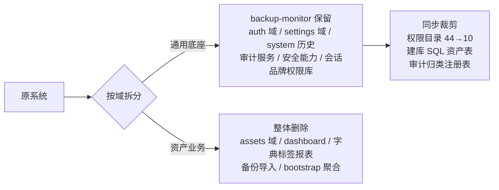

# Backup Monitor — 模板抽取计划与实施记录

> **文档说明**：本文档记录 Backup Monitor 通用前后端模板的抽取规划与实施过程，包括决策基线、抽取范围、分阶段改动清单与验证结果，作为理解模板来历与二次开发取舍的依据。
>
> 项目概览、运行方式与二次开发要点请回到 [README.md](../README.md)；开发规范见本地 `AGENTS.md`（未纳入版本控制）。

> **历史文档**：本文记录模板抽取与后续清理时期的状态，其中目录结构、测试文件数量与业务范围可能已变化；当前代码结构与运行方式以 [README.md](../README.md) 和 [docs/manual.md](manual.md) 为准。

## 目录

- [一、背景与目标](#一背景与目标)
- [二、决策基线](#二决策基线)
- [三、抽取范围](#三抽取范围)
- [四、分阶段实施记录](#四分阶段实施记录)
- [五、验证结果](#五验证结果)
- [六、遗留说明与注意事项](#六遗留说明与注意事项)
- [七、结构复查与优化（抽取后二次清理）](#七结构复查与优化抽取后二次清理)

# 一、背景与目标

以一套 Go + React 前后端分离的 IT 资产管理系统（下文称「原系统」）为基准，将其前后端中与业务无关的通用能力抽取为独立的项目模板 **backup-monitor**：一个「没有主服务功能、但自带通用底座」的骨架项目，新项目可直接在其上开发业务功能。

模板保留的能力边界：

- 登录（本地密码 / AD-LDAP / 企业微信扫码）、找回密码、修改密码
- 登录后的审计日志页与系统配置页
- 系统配置仅含四块：基础配置（品牌标识 + 安全时效）、用户配置（用户/群组/角色）、认证配置（LDAP + 企微）、通知配置（找回密码邮件 SMTP）
- 数据库使用 SQLite；其余资产功能（硬件、软件、合同、单据、文件、机架、地点、字典、标签、报表、浏览、仪表板）全部移除

# 二、决策基线

实施前确认的四项决策：

| 决策点 | 结论 |
| --- | --- |
| 项目目录与命名 | 项目根目录；Go module `backup-monitor-backend`、前端包名 `backup-monitor`、环境变量前缀 `BASE_` |
| 登录后落地页 | 重定向到审计日志 `/history`（原仪表板删除后，登录逻辑 3 处跳转 `/` 的断点由此修复） |
| 企业微信认证链路 | 保留（与资产功能零耦合，可整体干净保留） |
| 数据库备份/导入 | 前后端一并删除（基础配置面板的「数据备份」区块、备份调度、`/api/backups/database`、`/api/import/database` 均移除） |

另有一个重要事实：原系统后端本就使用 SQLite（`modernc.org/sqlite` 纯 Go 驱动、单文件库、`MaxOpenConns(1)`），因此「数据库换成 SQLite」无需更换驱动，只需裁剪资产表结构。

# 三、抽取范围



## 3.1 后端

**整目录删除**：`router/assets/`、`internal/common/statustypes/`、`backend/docs/`（Swagger 生成物，后重新生成）。

**文件级删除**：

- `router/`：`dashboard.go`、`bootstrap.go`、`asset_types.go`、`item_types.go`、`infrastructure_types.go`、`party_types.go`、`query_rows_compat.go`
- `router/system/`：`import_legacy.go`、`backups.go`、`backup_schedule.go`、`import_database.go`、`reset.go`（数据库导入回调随导入功能删除）
- `internal/repository/`：items、item_actions、item_mutations、software、invoices、contracts、agents、locations、racks、labels、browse、dictionaries 共 12 个
- `internal/service/`：全部资产 workflow、`backup.go`、`file_storage.go`、`audit_format.go`、`audit_lookup.go`、`dictionary_*.go`、`import_database.go` 及对应测试
- `internal/domain/`：资产请求类型、校验规则与资源常量共 9 个文件
- `router/common/files.go`（文件上传辅助，仅资产/备份使用）

**文件修改要点**：

| 文件 | 改动 |
| --- | --- |
| `go.mod` | module 改名 `backup-monitor-backend`；移除 excelize、go-pinyin 依赖 |
| `router/main.go` | App 结构瘦身（仅 audit/userWorkflow/authWorkflow 与三个路由器）；删除 `assetsDeps()`、`onDatabaseReplaced()`、备份调度、上传目录创建 |
| `router/routes.go` | 删除 assetsR、`/api/bootstrap`、`/api/dashboard/summary` 注册 |
| `router/system/db.go` | `databaseBootstrapSQL` 裁剪为 history、settings（legacy LDAP 列）、users、system_secrets 四表；默认 admin 账号保留 |
| `router/common/database_init.go` | 删除 statustypes 颜色、labelpapers、actions、tag 孤儿清理四个资产迁移 |
| `router/settings/settings_resources.go` | 权限目录 44 → 10 个 Key |
| `router/settings/settings_permission_normalize.go` | 内置角色权限改为审计+设置只读集合；legacy 迁移映射置空（机制保留） |
| `internal/service/user_workflow.go` | 删除删除用户时的硬件/合同占用检查与 `ReassignItems` |
| `internal/service/audit_classify.go` | 表注册表裁剪为 users/settings_*/password_reset_*/history/system_secrets；补回 `TruncateAuditTarget` 简化版 |
| `internal/domain/system_base.go` | 删除 Backup 三个字段与区块；默认品牌改为 Backup Monitor |
| `config/config.go` | 环境变量前缀改为 `BASE_`；删除 UploadDir；DBPath 默认 `./data/baseconsole.db` |
| Swagger | 注解块按函数清理后 `swag init -g cmd/server/main.go -o docs` 重新生成（保留 45 个注解函数） |

## 3.2 前端

**文件删除**（25 路由 + 43 feature 组件 + 杂项）：

- `routes/_authenticated/`：`assets/`（11 个）、`dictionaries/`（7 个）、`rack-view.$id.tsx`、`browse.tsx`、`tools.tsx`、`labels.tsx`、`reports.tsx`
- `features/`：`dashboard/`、`tools/`、`assets/` 三个目录整体
- `components/ui/tabs.tsx`（仅资产编辑器使用）、`lib/audit-track.ts`、`lib/file-download.ts`、`public/images/`

**文件修改要点**：

| 文件 | 改动 |
| --- | --- |
| `routes/_authenticated/index.tsx` | 改为 `beforeLoad` redirect 到 `/history` |
| `components/app-layout.tsx` | 侧栏导航 8 项 → 2 项（审计日志、系统配置）；删除 rack-view 特判与资产权限聚合 |
| `lib/permissions.ts` | PERM 仅保留 10 个 Key；`ANY_READ_PERMISSIONS = auditRead + 4 个 settings read` |
| `features/settings/BaseSettingsPanel.tsx` | 删除「数据备份」section、`BackupSettingsPanel`、backup 分支与校验；基础配置仅剩品牌标识 + 安全时效 |
| `features/settings/types.ts` | `SystemBaseConfig` 删除 backup 三字段，section 类型收窄 |
| `features/audit/AuditPage.tsx` | 模块枚举裁剪为 auth/audit/settings 三项 |
| `routes/__root.tsx`、`lib/branding.ts` | 标题与默认品牌改为 Backup Monitor / 备份监控系统 |
| `package.json` | name 改 `backup-monitor`；移除 recharts、qrcode、@types/qrcode |
| 全局痕迹 | localStorage 与事件名统一为 `bm.*` / `bm:*`；query key 改为 `['backup-monitor']`；CSS 类与变量前缀统一为 `bm-*`；主题类型改名为 `BmTheme` |

`routeTree.gen.ts` 为生成文件，由 `npm run build` 自动重生成。

# 四、分阶段实施记录

| 阶段 | 内容 | 结果 |
| --- | --- | --- |
| 0 骨架 | 创建目录、git init（不提交）、robocopy 复制前后端（排除 node_modules/.output/data/.git） | 完成 |
| 1a 后端删除 | 按上述清单批量删除资产文件与目录 | 完成 |
| 1b 后端修改 | module 改名与全局 import 替换、main/routes/system/settings/config/domain 裁剪、go mod tidy | 完成 |
| 1c 后端验证 | `go build` → `go vet` → `go test ./...` 逐轮修复（7 处测试引用旧权限/旧默认值，逐一改写）后全绿；Swagger 重新生成 | 全部通过 |
| 2a 前端删除 | 路由与 feature 资产文件删除 | 完成 |
| 2b 前端修改 | 落地页重定向、侧栏、权限、备份区块、审计枚举、全局痕迹替换、package.json | 完成 |
| 2c 前端验证 | `npm install` → `npm run build`（重生成 routeTree）→ `npm run type-check` | 全部通过 |
| 3 文档配置 | README.md、AGENTS.md、backend/.env.example（BASE_ 前缀）、deploy/ 与 scripts/ 复制去痕、.gitignore 精简（AGENTS.md 作为本地开发规范） | 完成 |
| 4 冒烟测试 | 启动前后端，Playwright 浏览器全流程走查 | 全部通过 |

# 五、验证结果

**自动化验证**：

- 后端：`go build ./... && go vet ./... && go test ./...` 全部通过（repository、service、router/auth、router/settings、router/system 等包测试全绿）
- 前端：`npm run type-check` 与 `npm run build` 通过；构建产物 `.output/` 正常生成

**接口冒烟**（curl）：

- `/api/health` 正常；`/api/public/base` 返回 Backup Monitor 品牌
- `admin/admin123` 登录成功签发 JWT；`/api/history` 正确返回审计记录
- `/api/settings/permissions` 返回恰好 10 个权限 Key
- 保存品牌配置后审计表新增 `settings | 更新基础配置 | 品牌标识 | success` 记录

**浏览器冒烟**（Playwright）：

- 未登录访问 `/` → SSR 重定向 `/history` → 认证守卫跳 `/login`；已登录访问 `/login` 弹回 `/history`
- 登录后侧栏仅「审计日志、系统配置」两项
- 系统配置四面板齐全：基础配置仅品牌标识 + 安全时效两个 section；用户配置含 1 用户、3 内置角色；认证配置含 AD/LDAP 与企业微信；通知配置为 SMTP 找回密码邮件
- 保存品牌后页面标题即时同步；找回密码页算术验证码正常；明暗主题切换渲染正常
- 浏览器控制台 0 错误 0 警告

# 六、遗留说明与注意事项

1. **提交状态**：仓库已 `git init` 但未做任何提交，首次提交由项目所有者执行；建议按 Conventional Commits 拆分为「后端抽取」「前端抽取」「文档配置」等原子提交。
2. **权限同步**：新增权限时必须同步修改后端 `permissionCatalog` 与前端 `lib/permissions.ts` 两处。
3. **审计接入**：新增业务表后需在 `internal/service/audit_classify.go` 的 `auditTableRegistry` 注册映射，写操作才会被正确归类审计。
4. **命名前缀约定**：环境变量 `BASE_*`、localStorage `bm.*`、事件 `bm:*`、CSS `bm-*`、query key `backup-monitor`，二次开发请延续。
5. **生产部署**：前端为 TanStack Start SSR，客户端请求走相对路径 `/api/*`，生产需反向代理转发 `/api` 到后端；Docker 一体化方案见 `deploy/`。
6. **默认账号**：`admin/admin123` 仅供首次登录，生产部署必须立即修改。

# 七、结构复查与优化（抽取后二次清理）

首次抽取完成后，对后端做了一轮残留复查与目录树优化。

## 7.1 残留清理

- `internal/common/localizer`：删除全部资产错误词表与正则（软件/位置/机架/标签/字典/合同等约 60 条），仅保留保留功能实际产生的英文消息（认证、用户、设置、数据库初始化约 15 条）与通用前缀、SQLite 约束兜底规则；文件由 246 行减至约 130 行
- 测试文件中的原系统示例值（SSO AppID、示例域名、临时库名）全部替换为中性命名，全仓原系统引用清零

## 7.2 目录树优化

| 变更 | 说明 |
| --- | --- |
| 删除 `pkg/` 层 | `pkg/database/rows.go` 的 `RowsToMaps` 并入 `internal/repository/rows.go`（使用方仅 repository 与 system 域） |
| 删除 `internal/common/primitives/` | 12 个函数中 9 个已无调用方（资产日期/文件名/ID 解析），剩余 3 个（`IntParamDefault`/`AsString`/`AsInt64`）并入 `internal/common/common.go` |
| 删除 `router/config_alias.go` | `Config`、`SessionUser` 别名并入 `router/main.go`（根包装配职责） |
| 删除 `router/system/types.go` | `system/db.go` 直接使用 `config.Config` |
| 删除 swagger 资产模型 | `swagger_models.go` 中 6 个无引用模型：`swaggerImportDatabaseResponse`、`swaggerDashboardSummaryResponse`、`swaggerReportRunResponse`、`swaggerLabelPreviewRequest`、`swaggerDictionaryPayload`、`swaggerTagPayload` |

优化后的后端目录树：

```
backend/
├── cmd/server/          # 服务入口
├── config/              # 环境变量加载
├── docs/                # Swagger 生成产物
├── internal/
│   ├── common/          # common.go（轻量工具）+ localizer/（错误中文化）
│   ├── domain/          # 请求/校验模型
│   ├── repository/      # SQL 访问层（含 rows.go）
│   ├── security/        # 密码哈希与密钥加密
│   └── service/         # 业务编排
└── router/
    ├── common/          # HTTP 基础设施与数据库迁移
    ├── auth/            # 认证域
    ├── settings/        # 设置域
    └── system/          # 系统域（审计、建库）
```

清理后验证：`go build`、`go vet`、`go test ./...`（6 包全绿）、`swag init` 重新生成且文档中原系统引用为 0。


# 九、表结构精简与文件名规范化（第四次重构）

## 9.1 表结构精简

| 变更 | 说明 |
| --- | --- |
| `settings_user_profiles` 并入 `users` | 邮箱、禁用、创建/更新/最近登录时间全部并入用户实体表，认证查询不再 LEFT JOIN |
| `settings_user_wecom` 并入 `users` | 企微绑定改为 `users.wecom_userid`（UNIQUE）单列，绑定/解绑/登录查询全部单表 |
| `settings_role_status` 并入 `roles` | 角色禁用改为 `roles.disabled` 列（种子 ON CONFLICT 不触碰该列，不会重置状态） |
| 移除 `users.usertype` | 原系统遗留列；管理员判定改为「admin 用户名 + 内置 admin 角色」（`UserAccess`/`HasPermission` 内特判），JWT 载荷与会话结构同步去除 `UserType` |
| 用户域表去 `settings_` 前缀 | `settings_roles`→`roles`、`settings_user_roles`→`user_roles`、`settings_user_groups`→`user_groups`、`settings_user_group_members`→`user_group_members`、`settings_user_group_roles`→`user_group_roles`；配置类表（settings_base/settings_email/settings_auth_providers）保留前缀以区分「配置」与「实体」 |
| `history` 更名 `audit_log` | 表名与「审计日志」语义对齐；API 路径 `/api/history` 保持不变 |
| 审计归类注册表 | `audit_classify.go` 的表→模块映射同步更新为新表名 |

**评估说明**：皇上建议的「`user_roles` 并入 `users`、`user_group_roles` 并入 `user_groups`」未采纳——二者是**多对多关联表**（一用户可多角色、一群组可多角色），并入实体表只能退化为 JSON 数组或单一角色模型，会破坏现有多角色权限聚合与「群组×角色」叠加授权能力，故保留独立关联表。

## 9.2 文件名规范化

- `internal/domain/`：`requests_auth_types.go`→`auth.go`、`requests_party_types.go`+`user_rules.go`→`user.go`、`system_base.go`→`base.go`
- `internal/security/`：`settings_secret.go`→`secret.go`
- `internal/repository/`：`domains.go`（域接口契约）→`contracts.go`、`domain.go`（共享实现）→`sqlite.go`
- `router/settings/`：包内文件去 `settings_` 冗余前缀（`settings_users.go`→`users.go`、`settings_permissions.go`+`settings_permission_normalize.go`→`permissions.go`、`settings_resources.go`→`catalog.go` 等）；`settings_helpers.go` 并入 `helpers.go`
- 别名 `types.go` 就近并入各域 `router.go`，不再单独建文件
- 命名规范全文见本地 `AGENTS.md` 第 1.4 节

## 9.3 测试文件

按指示移除模板携带的全部 Go 测试文件（22 个）；新增行为时的测试策略见 AGENTS.md 命名规范一节。

验证：`go build`/`go vet` 通过；九步接口冒烟（登录、me 无 userType、角色 disabled 正确、audit_log 写入、创建/禁用/删除用户全链路、群组、认证配置）与浏览器冒烟（用户配置页单表字段渲染）全部通过，控制台 0 错误 0 警告。


## 9.4 品牌图标与样式瘦身

- `frontend/public/favicon.svg` 与 `brand-mark.tsx` 默认品牌图标（登录页、加载动画、侧栏共用）同步重新设计：由 IT 机架造型改为「层叠底座」通用图形（呼应 Backup Monitor 定位）；移除深浅色主题差异化配色判断，背景固定为中等蓝色调（`#3568b0 → #274e8c` 渐变），两种主题下显示一致；`styles.css` 中 11 个 `--bm-logo-*` 主题变量随之删除
- `styles.css` 死样式清理：以「类名全仓引用检测」精确判定，删除 107 个无消费者的资产页面专用样式块（标签纸张、机架徽章、软件胶囊、单据文件、仪表板等），文件由 2719 行减至 1806 行；保留的布局/表单/侧栏/表格等通用样式经浏览器目测（登录、审计、设置三页，明暗主题）确认无样式破损
- 审计前端残留 `targetTitle` 死字段（3 处，后端已不返回）清除；全仓 `console.log` 调试残留 0 处
